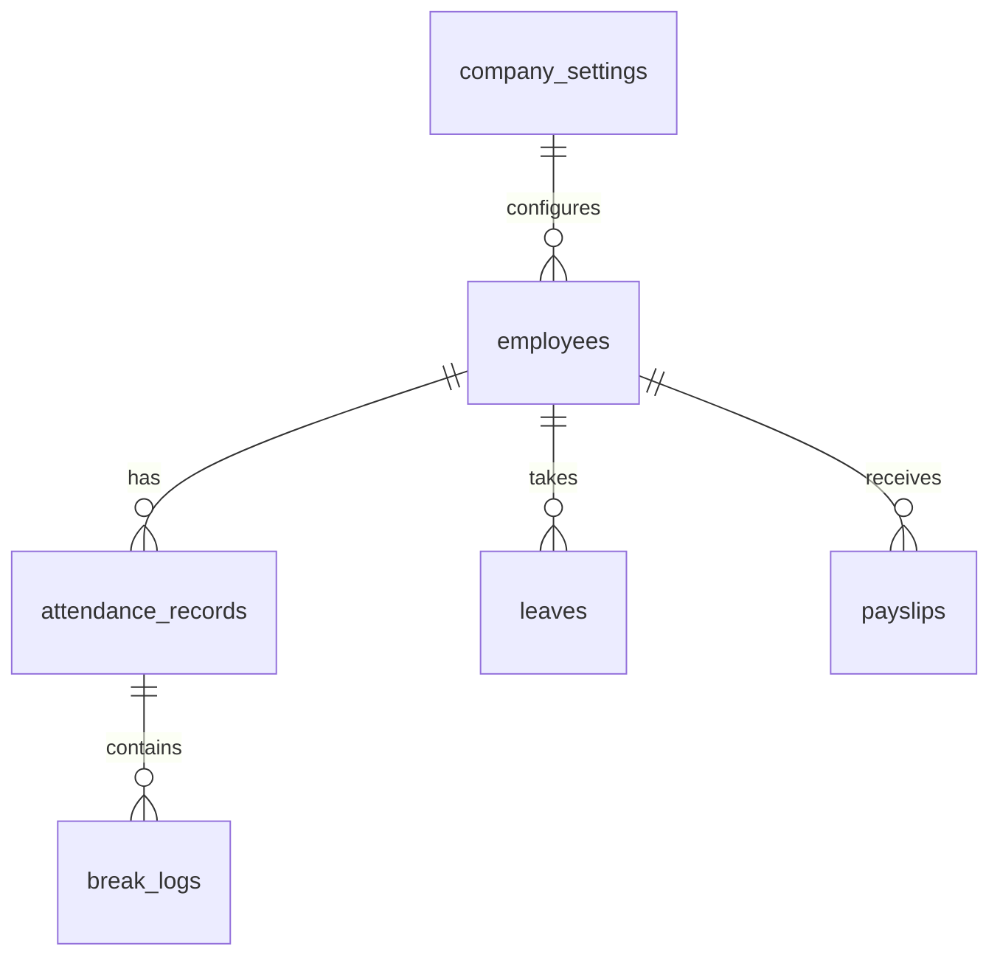

# سند معماری سیستم و مدل داده‌ها

این سند آنچه **در کد پیاده‌سازی شده** را توصیف می‌کند. هر ادعای این سند با فایل مشخصی در مخزن قابل بررسی است؛ اگر کد و سند اختلاف پیدا کردند، کد مرجع است و این سند باید اصلاح شود.

---

## ۱. نمای کلی

سه لایهٔ استاندارد Electron با مرز امنیتی کامل: Renderer هیچ دسترسی‌ای به Node، فایل‌سیستم یا پایگاه داده ندارد.

```mermaid
flowchart TB
    subgraph Main[Main Process - Node.js]
        M[main.cjs<br/>چرخهٔ عمر، پنجره، سیاست‌های امنیتی]
        IPC[ipc.cjs<br/>کانال‌های IPC + احراز هویت]
        REPO[db/repositories.cjs<br/>تمام عملیات داده]
        SCHEMA[db/schema.cjs<br/>جداول + مایگریشن‌ها]
        DB[(node:sqlite<br/>hozor_ghiab.db)]
        LIB[lib/*.cjs<br/>auth / time / errors / validate]
        BK[backup.cjs<br/>پشتیبان و بازیابی]
        M --> IPC --> REPO --> DB
        SCHEMA --> DB
        IPC --> LIB
        IPC --> BK
    end

    subgraph Bridge[Preload - sandboxed]
        P[preload.cjs<br/>contextBridge → window.api]
    end

    subgraph Renderer[Renderer - Chromium]
        APP[App.tsx<br/>bootstrap، قفل خودکار]
        STORE[store/useAppStore.ts<br/>Zustand]
        PAGES[pages/*<br/>Kiosk / Dashboard / Employees / Reports / Leaves / Payroll / Settings]
        COMP[components/*<br/>PayslipPreviewModal / DashboardOverview / AdminPasscodeModal ...]
        SRV[services/*<br/>api، date، money، payroll، excel، errors]
        I18N[i18n/locales/{ar,en,fa}.json]
        APP --> STORE --> SRV
        APP --> PAGES
        PAGES --> COMP
        PAGES --> STORE
        PAGES --> I18N
    end

    IPC <-->|ipcMain.handle / ipcRenderer.invoke| P
    P <-->|window.api| SRV
```

قواعد ثابت معماری:

1. **تمام محاسبات و دسترسی داده در Main انجام می‌شود.** Renderer فقط درخواست می‌فرستد و نتیجه را نمایش می‌دهد.
2. **Renderer هرگز مبلغ نهایی یا مدت خالص را تعیین نمی‌کند.** اگر کلاینت مقدار ناسازگاری بفرستد، Main آن را نادیده می‌گیرد و خودش محاسبه می‌کند (`savePayslip`, `punchOut`, `correctAttendance`).
3. **پاسخ کانال‌ها همیشه شکل ثابت دارد:** `{ ok: true, data }` یا `{ ok: false, error: { code, message } }`. کد خطا برای ترجمه استفاده می‌شود، پیام فقط برای لاگ.

---

## ۲. پشتهٔ فناوری و دلیل انتخاب

| لایه | فناوری | دلیل |
| :--- | :--- | :--- |
| دسکتاپ | Electron 45.5.0 | خروجی `.exe` مستقل، چاپ/PDF بومی، بدون نیاز به مرورگر |
| پایگاه داده | **`node:sqlite`** (`DatabaseSync`) | Electron 45 خودش Node 24.22 دارد و این ماژول در آن موجود است؛ پس **صفر ماژول نیتیو، صفر `electron-rebuild`**. `better-sqlite3` حذف شد چون در بسته‌بندی نیاز به کامپایل مجدد و هم‌نسخه‌سازی ABI داشت. |
| رابط کاربری | React 19 + TypeScript | تایپ‌های دقیق برای مبالغ و زمان‌ها، کامپوننت‌های قابل تست |
| بیلد | Vite 6 | بیلد سریع، `manualChunks` برای جدا کردن ExcelJS |
| استایل | Tailwind 3.4 | کلاس‌های `rtl:`/`ltr:` برای سه زبان |
| وضعیت | Zustand 5 | فروشگاه کوچک، بدون Provider، قابل استفاده در تست |
| چندزبانه | i18next | سه فایل JSON هم‌ساختار، تغییر جهت صفحه بر اساس زبان |
| اکسل | ExcelJS | استایل شیت، سربرگ، فرمول؛ با `await import()` فقط هنگام خروجی بارگذاری می‌شود |
| تست | Vitest 3 | تست منطق پول/زمان و تست یکپارچهٔ پایگاه داده روی `:memory:` |
| بسته‌بندی | electron-builder 26 | NSIS، asar، خروجی قابل توزیع |

**کد Main به‌صورت CommonJS (`*.cjs`)** نوشته شده و `package.json` مقدار `"type": "module"` دارد؛ بنابراین Renderer/تست‌ها ESM هستند و Main بدون ترنسپایل اجرا می‌شود.

---

## ۳. مسئولیت پروسس‌ها

### ۳.۱. Main (`src/main/`)

| فایل | مسئولیت |
| :--- | :--- |
| `main.cjs` | قفل تک‌نمونه‌ای، سیاست‌های امنیتی، ساخت پنجره، `loadURL` در توسعه و `loadFile(dist/index.html)` در نسخهٔ نصبی، پشتیبان خودکار در `before-quit`، بستن پایگاه داده در `will-quit` |
| `preload.cjs` | تنها پل مجاز: `window.api` با متدهای مشخص و ثابت (بدون عبور نام کانال از Renderer) |
| `ipc.cjs` | ثبت همهٔ کانال‌ها، احراز هویت جلسه، محدودیت تلاش ورود، دیالوگ‌های فایل، چاپ و PDF |
| `db/index.cjs` | باز کردن اتصال، `PRAGMA journal_mode=WAL`، `foreign_keys=ON`، `busy_timeout=5000`، اجرای مایگریشن‌ها، `withTransaction` |
| `db/schema.cjs` | تعریف جداول و مایگریشن‌های نسخه‌دار (`PRAGMA user_version`) |
| `db/repositories.cjs` | تمام پرس‌وجوها و قواعد کسب‌وکار داده (تنها جایی که SQL نوشته می‌شود) |
| `backup.cjs` | ساخت/اعتبارسنجی/نوشتن اتمیک پشتیبان، بازیابی، پشتیبان خودکار با نگه‌داری ۳۰ نسخه |
| `lib/auth.cjs` | هش scrypt، ساخت/خواندن/ابطال نشست در حافظه |
| `lib/time.cjs` | کلید تاریخ محلی، مرزهای روز، محاسبهٔ دقایق، اضافه‌کار، روزهای مرخصی |
| `lib/errors.cjs` | `appError(code)` و تبدیل امن خطا به پاسخ IPC |
| `lib/validate.cjs` | اعتبارسنجی ورودی‌ها (رشته، عدد، تاریخ، شمارهٔ تلفن، مبلغ) |

### ۳.۲. Renderer (`src/renderer/`)

| فایل | مسئولیت |
| :--- | :--- |
| `App.tsx` | bootstrap اولیه، تعیین وضعیت `loading/setup/ready/error`، قفل خودکار پس از ۱۰ دقیقه بی‌کاری، انقضای نشست |
| `store/useAppStore.ts` | وضعیت سراسری: تنظیمات، کارمندان عمومی، رکورد امروز، توکن نشست، actions تردد |
| `services/api.ts` | پل تایپ‌شده روی `window.api`، مدیریت توکن، تشخیص نبود محیط دسکتاپ (`electron_required`) |
| `services/date.ts` | تاریخ محلی (بدون UTC)، قالب‌بندی تاریخ/ساعت بر اساس زبان، تقویم میلادی |
| `services/money.ts` | تبدیل مبلغ ماژور/مینور، قالب‌بندی با تعداد اعشار واحد پول |
| `services/payroll.ts` | توابع خالص حقوق: نرخ روزانه/ساعتی، پیشنهاد حقوق پایه، اضافه‌کار، کسر مرخصی بدون حقوق، خالص |
| `services/excel.ts` | خروجی اکسل با جهت شیت بر اساس زبان |
| `services/errors.ts` | تبدیل کد خطا به کلید ترجمه |
| `pages/*` | کیوسک، داشبورد، کارمندان، گزارش تردد، مرخصی، حقوق، تنظیمات. صفحهٔ کیوسک با هر بار نمایش و سپس هر ۶۰ ثانیه فهرست عمومی کارمندان و رکوردهای امروز را تازه می‌کند |
| `components/*` | هدر (شامل انتخاب زبان و ساعت سیستم)، مودال رمز، راه‌اندازی اولیه (دارای سوئیچر زبان سه‌گانه)، اصلاح تردد، گزارش کارمند، تأیید، نوار پیام |
| `i18n/locales/*.json` | کاتالوگ کامل سه زبان (۲۷۰ کلید هم‌ساختار) |

---

## ۴. قرارداد IPC

هر متد `window.api` یک کانال ثابت را صدا می‌زند و همان پاسخ `{ok,data}`/`{ok:false,error}` را برمی‌گرداند.

| گروه | کانال‌ها | نیازمند نشست |
| :--- | :--- | :--- |
| برنامه | `app:info` | – |
| احراز هویت | `auth:status`, `auth:login`, `auth:logout`, `auth:change-password`, `auth:emergency-reset` | – (به‌جز change-password) |
| تنظیمات | `settings:get` (عمومی)، `settings:update`, `settings:complete-setup` | update ✔ |
| کارمندان | `employees:public` (فقط نام/کد/بخش)، `employees:list/save/set-active/delete` | ✔ |
| تردد | `attendance:today`, `punch-in`, `start-break`, `end-break`, `punch-out` (کیوسک) | – |
| تردد مدیریتی | `attendance:list`, `attendance:aggregate`, `attendance:correct`, `attendance:delete` | ✔ |
| مرخصی | `leaves:list/save/delete/unpaid-days` | ✔ |
| حقوق | `payslips:list/save/set-signed/delete` | ✔ |
| رویدادها | `audit:list` | ✔ |
| پشتیبان | `backup:export`, `backup:restore` | ✔ |
| چاپ | `print:payslip`, `print:payslip-pdf` | ✔ |
| به‌روزرسانی | `updater:check`, `updater:download`, `updater:install`, `updater:status` | – |

نکات پیاده‌سازی:

- `handle(channel, fn, { requiresAuth })` در `ipc.cjs` توکن را از آرگومان جدا می‌کند، جلسه را اعتبارسنجی می‌کند و در صورت نبود یا انقضا `unauthorized` برمی‌گرداند.
- ورود موفق یک توکن تصادفی ۳۲ بایتی می‌سازد؛ پس از ۵ تلاش ناموفق، ورود برای مدت کوتاه با `auth_locked` مسدود می‌شود.
- کانال‌های کیوسک هیچ دادهٔ حقوقی برنمی‌گردانند؛ `listPublicEmployees` فقط `id, fullName, employeeCode, department` می‌دهد (تست دارد).

---

## ۵. مدل امنیتی

| موضوع | پیاده‌سازی |
| :--- | :--- |
| رمز مدیر | حداقل ۴ کاراکتر، scrypt با نمک تصادفی، قالب `scrypt$N$r$p$salt$hash`؛ مقایسه فقط در Main |
| بازیابی اضطراری رمز | فعال‌سازی با ۵ کلیک روی آیکون قفل یا لینک مخفی؛ احراز با نام کارفرما/شرکت یا کد پشتیبان ۹۶۵۰؛ ثبت لاگ audit با اکتور recovery |
| نشست | در حافظهٔ Main، `SESSION_TTL_MS = 30 دقیقه`، ابطال دسته‌جمعی هنگام بازیابی پشتیبان |
| توکن در Renderer | فقط در حافظهٔ Zustand؛ در `localStorage` نوشته نمی‌شود و با بستن/قفل برنامه از بین می‌رود |
| خروج صریح | دکمهٔ خروج (Logout) اختصاصی در هدر و داشبورد، پاک‌سازی نشست و بازگشت به کیوسک |
| قفل خودکار | ۱۰ دقیقه بی‌کاری در `App.tsx` → خروج از نشست و بازگشت به کیوسک |
| پنجره | `contextIsolation: true`, `sandbox: true`, `nodeIntegration: false`, `devTools` فقط در توسعه |
| DevTools | در نسخهٔ نصبی F12 / Ctrl+Shift+I / Cmd+Alt+I مسدود می‌شود |
| ناوبری | `will-navigate` فقط آدرس dev server (توسعه) یا `file://` (محصول)؛ `window.open` فقط `wa.me` به مرورگر سیستم |
| دسترسی‌ها | همهٔ `setPermissionRequestHandler` رد می‌شوند |
| CSP | متاتگ CSP فقط در بیلد تولیدی توسط پلاگین `vite.config.ts` تزریق می‌شود |
| به‌روزرسانی | ماژول `electron-updater` از طریق GitHub Releases؛ بدون دستکاری پایگاه داده؛ بیلد خودکار توسط GitHub Actions |

---

## ۶. مدل داده

مسیر فایل: `app.getPath("userData")/hozor_ghiab.db` → در ویندوز `%APPDATA%\hozor-ghiab\hozor_ghiab.db` (نسخهٔ نصب‌شده و اجرای توسعه هر دو همین مسیر را می‌سازند؛ بررسی‌شده روی نصب واقعی). فایل‌های برنامه در `%LOCALAPPDATA%\Programs\hozor-ghiab` قرار می‌گیرند. استثناء: اگر پوشهٔ قدیمی `%APPDATA%\Hozor Ghiab` وجود داشته باشد، برنامه عمداً همان را به‌عنوان `userData` انتخاب می‌کند (مهاجرت نرم، بدون از دست رفتن دادهٔ نصب‌های قبلی).
`journal_mode=WAL`، `foreign_keys=ON`، `busy_timeout=5000`.



### ۶.۱. `company_settings` (همیشه یک ردیف، `id = 1`)

`company_name, owner_name, owner_role, admin_password_hash, currency, currency_decimals, default_daily_hours, standard_work_days, overtime_multiplier, is_configured, logo_path, updated_at`

- `admin_password_hash` خالی = راه‌اندازی اولیه انجام نشده (`is_configured = 0`).
- `currency_decimals` تعداد اعشار واحد پول است (KWD = ۳). هیچ‌جای کد دو رقم ثابت فرض نشده.

### ۶.۲. `employees`

`id (TEXT PK), full_name, employee_code (UNIQUE), phone, department, salary_type, base_rate_minor (INTEGER ≥ 0), is_active, created_at, updated_at`

- `salary_type ∈ {fixed_monthly, hourly, daily, custom}`
- `base_rate_minor` مبلغ به **کوچک‌ترین یکای پول** است (فیل برای KWD).

### ۶.۳. `attendance_records`

`id (TEXT PK), employee_id (FK → employees, ON DELETE CASCADE), record_date (YYYY-MM-DD), punch_in_at (epoch ms), punch_out_at (epoch ms | NULL), break_minutes, net_minutes, status, notes, created_at, updated_at`

- `UNIQUE (employee_id, record_date)` → **یک شیفت در روز**؛ کلاس کامل باگ «رکورد دوم پنهان» را حذف می‌کند.
- `status ∈ {present, on_break, completed, absent}`؛ شیفت باز = `punch_out_at IS NULL`.
- زمان‌ها **epoch میلی‌ثانیه** هستند؛ `record_date` از **تاریخ محلی** ساخته می‌شود نه UTC.
- `net_minutes` همیشه در Main و معمولاً از دل همان تراکنش محاسبه می‌شود.

### ۶.۴. `break_logs`

`id (TEXT PK), attendance_id (FK → attendance_records, ON DELETE CASCADE), break_start_at, break_end_at (NULL = باز), duration_minutes`

### ۶.۵. `leaves`

`id, employee_id (FK), leave_type ∈ {paid, unpaid, sick, emergency}, start_date, end_date, days, is_paid, reason, created_at, updated_at`

- `days` شامل هر دو سر بازه است (`inclusiveDayCount`).
- مرخصی بدون حقوق در محاسبهٔ حقوق از نرخ روزانه کسر می‌شود (فقط برای حقوق ماهانه ثابت).

### ۶.۶. `payslips`

`id, number (UNIQUE, PS-YYYY-NNNN), employee_id, employee_name, employee_code, department, salary_type, base_rate_minor, period_start, period_end, worked_days, worked_minutes, break_minutes, overtime_minutes, unpaid_leave_days, base_salary_minor, overtime_amount_minor, bonuses_minor, deductions_minor, net_amount_minor, payment_date, payment_method ∈ {cash, bank_transfer, cheque, knet}, notes, is_signed, signed_at, created_at, updated_at`

- نام و کد کارمند در فیش **کپی** می‌شود تا سند پرداخت پس از تغییر نام هم معتبر بماند.
- `net_amount_minor` در Main محاسبه می‌شود؛ مقدار ارسالی کلاینت دور ریخته می‌شود.
- شمارهٔ فیش در همان تراکنش ذخیره ساخته می‌شود (`PS-YYYY-NNNN`، بدون شکاف، بدون استفادهٔ دوباره از شماره).
- برای هر (کارمند، دوره) فقط **یک** فیش مجاز است؛ درخواست دوم با `payslip_period_exists` رد می‌شود تا پرداخت دوباره رخ ندهد و مسیر درست، ویرایش همان فیش است.

### ۶.۷. `audit_logs`

`id (INTEGER PK AUTOINCREMENT), at, actor, entity, entity_id, action, details`

ثبت رویدادهای حساس: ورود، تغییر رمز، ذخیره/حذف کارمند، اصلاح یا حذف تردد، مرخصی، فیش، بازیابی پشتیبان.

### ۶.۸. نسخه‌بندی Schema

- نسخه در `PRAGMA user_version` نگه داشته می‌شود؛ نسخهٔ فعلی **۲**.
- هر مایگریشن در یک تراکنش `BEGIN IMMEDIATE … COMMIT` اجرا می‌شود و در صورت خطا `ROLLBACK`.
- **v1**: ساخت کامل جداول و ایندکس‌ها + ردیف پیش‌فرض تنظیمات.
- **v2**: تضمین وجود `audit_logs` و بازسازی جدول `payslips` به شکل نهایی (`signed_at`، حذف قید یکتایی دوره و پیش‌فرض «امضاشده») تا پایگاه‌داده‌های ساخته‌شده با نسخهٔ قبلی هم بدون از دست رفتن داده کار کنند.
- اگر `user_version` بزرگ‌تر از نسخهٔ برنامه باشد، برنامه با خطای واضح بالا نمی‌آید (جلوگیری از خرابی داده).

---

## ۷. قواعد کسب‌وکار (و باگ‌هایی که این قواعد می‌بندند)

| قاعده | پیاده‌سازی | باگ قبلی |
| :--- | :--- | :--- |
| روز کاری از **تاریخ محلی** | `time.localDateKey` (بدون `toISOString`) | تردد ۰۰:۰۰–۰۳:۰۰ به روز قبل می‌خورد |
| پایان شیفت در حالت استراحت | `punchOut` استراحت باز را در **همان تراکنش** می‌بندد و `break_minutes`/`net_minutes` را از پایگاه داده دوباره می‌خواند | آرایهٔ قدیمی رکورد را بازنویسی می‌کرد و استراحت کسر نمی‌شد |
| یک شیفت در روز | `UNIQUE(employee_id, record_date)` + خطای `attendance_already_completed` | رکورد دوم پنهان، دو بار شمرده می‌شد |
| ورود تکراری روی شیفت باز | همان رکورد برگردانده می‌شود (idempotent) | امکان رکورد تکراری |
| اضافه‌کار | `net_minutes - default_daily_hours*60` (از **تنظیمات**)، ضریب `overtime_multiplier` | `defaultDailyHours` خوانده نمی‌شد |
| حقوق بدون داده | هشدار «سجلی در این دوره نیست» همیشه نمایش داده می‌شود؛ روز و ساعت هرگز فرض نمی‌شود. برای کارمند ساعتی/روزانه مبلغ صفر است و برای کارمند ماهانه فقط حقوق پایهٔ قراردادی (بدون اضافه‌کار جعلی) | `records.length \|\| 26` و `daysCount*8` |
| حذف کارمند | اگر تردد/مرخصی/فیش داشته باشد → `employee_has_history` | فیش‌های حقوقی (سند پرداخت) پاک می‌شدند |
| اصلاح دستی تردد | `correctAttendance` مقادیر را اعتبارسنجی، `net_minutes` را بازمحاسبه و در `audit_logs` ثبت می‌کند | وجود نداشت |
| مرخصی | روزهای شامل + کسر از حقوق ماهانه | فقط type و کلید ترجمه وجود داشت |
| انتخاب کارمند در صفحهٔ حقوق | دیالوگ «إنشاء كشف راتب» همیشه با همان کارمندی باز می‌شود که در فیلتر صفحه انتخاب شده (و اگر فیلتر روی «همه» باشد، اولین کارمند فعال) | پیش از این همیشه اولین کارمند فعال باز می‌شد و ممکن بود مبلغ نفر دیگری نمایش داده شود |
| چاپ فیش | `print:payslip` و `print:payslip-pdf` در Main با `webContents.print` / `printToPDF` | کد مرده بود |

---

## ۸. مدل پول

- همهٔ مبالغ در پایگاه داده و تایپ‌ها **عدد صحیح minor units** هستند (فیل برای KWD).
- تبدیل فقط در لبه‌های UI انجام می‌شود: `fromMajor/toMajor`, `fromInputValue/toInputValue`.
- `roundMinor` برای جمع/کسر با گرد کردن نیم‌به‌بالا و بدون نتیجهٔ منفی.
- قالب‌بندی با `Intl.NumberFormat` و `currency_decimals` تنظیمات؛ برای واحدهای غیر ISO (مثل «تومان») قالب سادهٔ عدد + نام واحد.
- هیچ محاسبهٔ مالی با `parseFloat` روی رشتهٔ ورودی و هیچ جمع اعشاری در کد وجود ندارد.

---

## ۹. زمان و تقویم

- `record_date` همیشه تاریخ **میلادی محلی** (`YYYY-MM-DD`) است.
- نمایش تاریخ با `Intl.DateTimeFormat` و لوکال‌های `en-GB-u-ca-gregory-nu-latn` / `ar-KW-u-ca-gregory-nu-latn` / `fa-IR-u-ca-gregory-nu-latn` انجام می‌شود تا تقویم میلادی بماند و ارقام لاتین نمایش داده شوند (بدون تبدیل جلالی/هجری).
- مدت‌ها به دقیقهٔ صحیح نگه داشته می‌شوند و برای نمایش به «ساعت و دقیقه» تبدیل می‌شوند.

---

## ۱۰. چندزبانه

- سه فایل `src/renderer/i18n/locales/{ar,en,fa}.json` با **۲۷۰ کلید هم‌ساختار**.
- هیچ متن قابل‌ترجمه‌ای در JSX هاردکد نشده؛ تنها استثنا نام زبان‌ها در منوی انتخاب زبان («العربية»، «فارسی») که عمداً به زبان خودشان نوشته می‌شوند.
- جهت صفحه در `i18n/config.ts` (تابع `setAppLanguage`) تعیین و روی `<html dir>` و `<html lang>` اعمال می‌شود؛ انگلیسی LTR و عربی/فارسی RTL.
- خطاهای پروسس اصلی با **کد** منتقل می‌شوند و در Renderer به کلید ترجمه نگاشت می‌شوند (`services/errors.ts`).
- خروجی اکسل جهت شیت را از زبان فعال می‌گیرد (قبلاً همیشه RTL بود).

---

## ۱۱. پشتیبان و بازیابی

```json
{
  "app": "hozor-ghiab",
  "formatVersion": 1,
  "schemaVersion": 2,
  "exportedAt": "2026-11-25T…",
  "data": { "settings": {}, "employees": [], "attendance": [], "leaves": [], "payslips": [] }
}
```

- `validateBackup` قبل از هر تغییری اعتبارسنجی می‌کند: شناسهٔ برنامه، نسخهٔ فرمت، وجود آرایه‌ها، اعتبار تاریخ‌ها و ارجاع هر رکورد به کارمند موجود.
- نسخهٔ جدیدتر → `backup_newer_version` (بدون دست‌زدن به داده).
- بازیابی در یک تراکنش انجام می‌شود و پس از آن همهٔ نشست‌ها ابطال می‌شوند.
- نوشتن فایل به‌صورت اتمیک (نوشتن موقت + rename) است.
- پشتیبان خودکار در `backups/` کنار فایل پایگاه داده: پس از `PRAGMA wal_checkpoint(TRUNCATE)` یک کپی باینری `.db` گرفته می‌شود و ۳۰ نسخهٔ آخر نگه داشته می‌شود (بررسی‌شده: بستن عادی پنجره یک فایل ۱۲۰KB می‌سازد).

---

## ۱۲. بیلد، بسته‌بندی و توزیع

- `npm run build` = `tsc --noEmit` + `vite build` → `dist/`
- Renderer در نسخهٔ نصبی با `loadFile(dist/index.html)` بارگذاری می‌شود؛ در توسعه با `loadURL(http://localhost:5173)`.
- `electron-builder` فایل‌های `dist/**/*`، `src/main/**/*` و `package.json` را داخل `app.asar` می‌گذارد (بررسی شده: `dist/index.html` و chunkها داخل asar هستند).
- خروجی‌ها: `release/win-unpacked/نظام الحضور والرواتب.exe` (بدون نصب) و `release/نظام-الحضور-والرواتب-<version>-setup.exe` (NSIS، نصب برای کاربر جاری در `%LOCALAPPDATA%\Programs\hozor-ghiab`، امکان انتخاب مسیر).
- چانک‌ها: `index` (~۴۰۹KB)، `i18n` (~۶۵KB)، `react`، `exceljs` (~۹۴۰KB، فقط با `import()` هنگام خروجی اکسل).
- آیکون اختصاصی چنداندازه‌ای ویندوز (`build/icon.ico` و `build/icon.png`) و نام رسمی عربی «نظام الحضور والرواتب» برای شرت‌کات دسکتاپ و نصاب NSIS تنظیم شده است.

---

## ۱۳. تست و CI

- `tests/time.test.ts` — تاریخ محلی (شامل رگرسیون نیمه‌شب UTC)، مرز روز، دقایق، اضافه‌کار.
- `tests/money.test.ts` — تبدیل minor units، سه اعشار KWD، گرد کردن، خطای شناور.
- `tests/payroll.test.ts` — نرخ روزانه/ساعتی، حقوق هر سه نوع، اضافه‌کار، کسر مرخصی، خالص، حالت بدون داده.
- `tests/database.test.ts` — رویِ `:memory:`: کسر استراحت در `punchOut`، جلوگیری از رکورد دوم، idempotent بودن ورود، خطاهای استراحت، اصلاح دستی، تجمیع، گارد حذف کارمند، یکتایی کد پرسنلی، پروجکشن کیوسک، شمارهٔ فیش و محاسبهٔ خالص در Main، رد فیش تکراری برای یک دوره، مرخصی، اعتبارسنجی پشتیبان.
- `npm test` → **۵۰ تست**.
- `.github/workflows/ci.yml` روی هر push/PR: نصب، `typecheck`، `test`، `build`.

---

## ۱۴. محدودیت‌های شناخته‌شده

1. امضای کد (Code signing) تنظیم نشده؛ نصب‌کننده بدون امضا ساخته می‌شود و ویندوز SmartScreen ممکن است هشدار بدهد. آیکون اختصاصی تنظیم شده است.
2. چاپ به درایور چاپگر ویندوز وابسته است؛ در محیط بدون چاپگر، خروجی PDF مسیر جایگزین است.
3. تقویم فقط میلادی است (طبق نیاز کویت)؛ تبدیل هجری/جلالی در محدودهٔ پروژه نیست.
4. پشتیبان دستی (خروجی و بازیابی داخل برنامه) به‌صورت JSON است؛ پشتیبان خودکار کپی باینری `.db` است و از رابط کاربری بازیابی نمی‌شود (فقط تعویض دستی فایل).
5. هیچ همگام‌سازی چنددستگاهی وجود ندارد؛ برنامه تک‌رایانه‌ای و آفلاین است.
